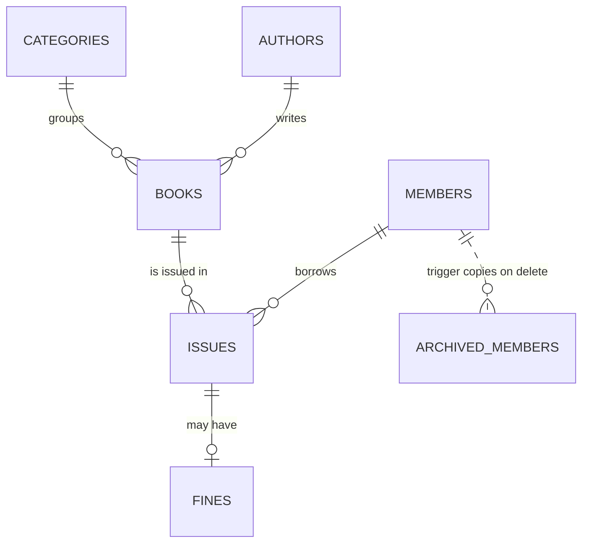
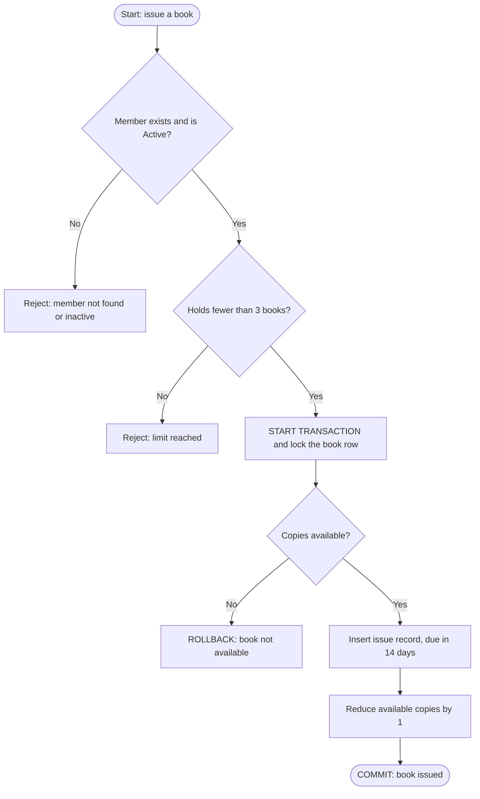

# 📚 Library Management System (MySQL)

A beginner-friendly **MySQL database project** that manages a library: books, authors, members, book issues, returns and fines.

It is built to show, in one realistic project, every core SQL concept: **DDL, DML, DQL, Joins, Subqueries, Correlated Subqueries, Set Operators, Views, Stored Procedures, Function, Trigger and Transactions (TCL)**.

> **Developed by:** Battula Koteswararao

---

## 📑 Contents

1. [What this project does](#-what-this-project-does)
2. [Database design (ER diagram)](#-database-design-er-diagram)
3. [Tables explained](#-tables-explained)
4. [Concepts covered](#-concepts-covered)
5. [How a book gets issued](#-how-a-book-gets-issued)
6. [How to run](#-how-to-run)
7. [Sample queries](#-sample-queries)
8. [Project structure](#-project-structure)

---

## 🎯 What this project does

- Stores books, authors, categories and members
- Records every book **issue** and **return**
- Calculates **fines** for late returns (₹2 per late day)
- Reports **overdue books**, popular books and active borrowers
- Keeps stock counts correct using **transactions**

**Business rules built into the database**

| Rule | Where it is enforced |
|---|---|
| A member can hold at most **3 books** at a time | `sp_issue_book` |
| **Inactive** members cannot borrow | `sp_issue_book` |
| A book can't be issued when **no copies** are left | `sp_issue_book` + `CHECK` constraint |
| Fine = **₹2 per late day** | `fn_calc_fine` |
| A deleted member is **archived automatically** | `trg_archive_member` |

---

## 🗺️ Database design (ER diagram)


**How to read it:** `PK` = primary key, `FK` = foreign key, `UK` = unique.
One **author** writes many **books**, one **member** borrows many **issues**, and one **issue** may have one **fine**.

<details>
<summary>Same diagram as text (Mermaid) - click to expand</summary>



</details>

---

## 🧱 Tables explained

| Table | Purpose | Key columns |
|---|---|---|
| `categories` | Book categories (Programming, Fiction ...) | `category_id`, `category_name` |
| `authors` | Book authors | `author_id`, `author_name`, `country` |
| `books` | Every book with price and stock | `book_id`, `author_id`, `category_id`, `available_copies` |
| `members` | Library members | `member_id`, `email`, `membership_type`, `status` |
| `issues` | Which member took which book and when | `issue_id`, `book_id`, `member_id`, `due_date`, `return_date` |
| `fines` | Fine charged for a late return | `fine_id`, `issue_id`, `amount`, `paid` |
| `archived_members` | Members who were deleted (filled by a trigger) | `member_id`, `full_name`, `archived_on` |

---

## 🧠 Concepts covered

| Concept | What is used in this project |
|---|---|
| **DDL** | `CREATE`, `ALTER`, `CREATE INDEX`, `TRUNCATE`, `DROP`, constraints (`PRIMARY KEY`, `FOREIGN KEY`, `CHECK`, `UNIQUE`) |
| **DML** | `INSERT` sample data, `UPDATE` prices and status, `DELETE` records |
| **DQL** | `SELECT` with `WHERE`, `LIKE`, `BETWEEN`, `GROUP BY`, `HAVING`, `ORDER BY`, `LIMIT`, `CASE` |
| **Joins** | Inner, Left, Right, Self, Cross, Full Outer (emulated) |
| **Subqueries** | Scalar, `IN` / `NOT IN`, derived table, `ALL` |
| **Correlated subqueries** | Books above their category average, latest issue per member, `EXISTS` / `NOT EXISTS` |
| **Set operators** | `UNION`, `UNION ALL`, `INTERSECT`, `EXCEPT` |
| **Views** | `vw_book_catalog`, `vw_active_issues`, `vw_overdue_books`, `vw_member_summary`, `vw_active_members` |
| **Stored procedures** | `sp_add_member`, `sp_issue_book`, `sp_return_book`, `sp_member_history` |
| **Function** | `fn_calc_fine` |
| **Trigger** | `trg_archive_member` |
| **TCL** | `START TRANSACTION`, `COMMIT`, `ROLLBACK`, `SAVEPOINT` |

---

## 🔄 How a book gets issued

This is the logic inside the `sp_issue_book` procedure.



**Why a transaction?** The issue record and the stock update must happen **together**. If one step fails, everything is rolled back, so the stock count is never wrong.

---

## ▶️ How to run

**Requirement:** MySQL **8.0.31 or later** (needed for `INTERSECT` and `EXCEPT`).

**Option 1: Command line**
```bash
git clone https://github.com/YOUR-USERNAME/library-management-system-mysql.git
cd library-management-system-mysql
mysql -u root -p < library_management_system.sql
```

**Option 2: MySQL Workbench**
1. Open MySQL Workbench and connect to your server.
2. Go to **File → Open SQL Script** and choose `library_management_system.sql`.
3. Click the ⚡ **Execute** button.

The script creates a database called `library_db`, with all tables, sample data, views, procedures, the function and the trigger.

> ⚠️ The script starts with `DROP DATABASE IF EXISTS library_db;`, so running it again resets the database.

---

## 🔍 Sample queries

After running the script, try these:

```sql
USE library_db;

-- All overdue books with the fine so far
SELECT * FROM vw_overdue_books;

-- Book catalog with author and category
SELECT * FROM vw_book_catalog WHERE category_name = 'Programming';

-- Issue a book (member 2 takes book 7) and read the result message
CALL sp_issue_book(7, 2, @msg);
SELECT @msg;

-- Return a book and see the fine charged
CALL sp_return_book(5, @fine);
SELECT @fine;

-- A member's full borrowing history
CALL sp_member_history(1);
```

> Fines depend on today's date, so your numbers may differ from the sample data.

---

## 📁 Project structure

```
library-management-system-mysql/
├── README.md
├── library_management_system.sql     # full project: tables, data, queries, procedures
└── docs/
    ├── er_diagram.png                # ER diagram
    └── Library_Management_System.pptx  # project presentation
```

---

## 👤 Author

**Battula Koteswararao**

If you found this project useful, give it a ⭐ on GitHub!
